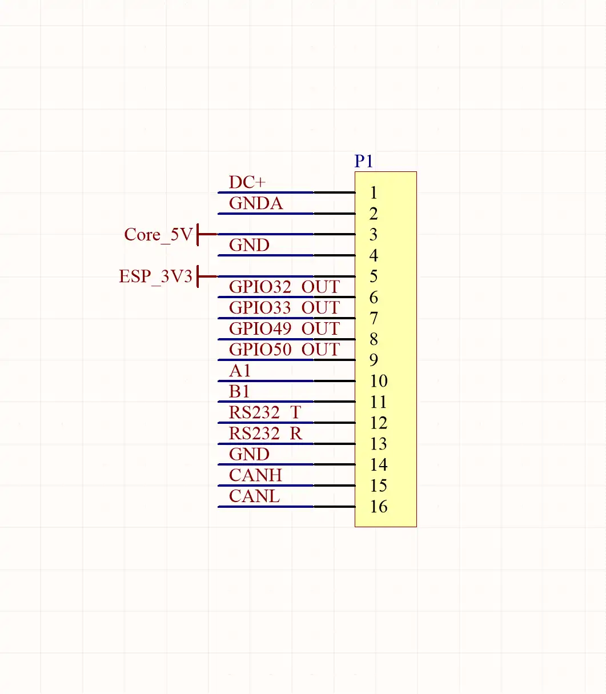
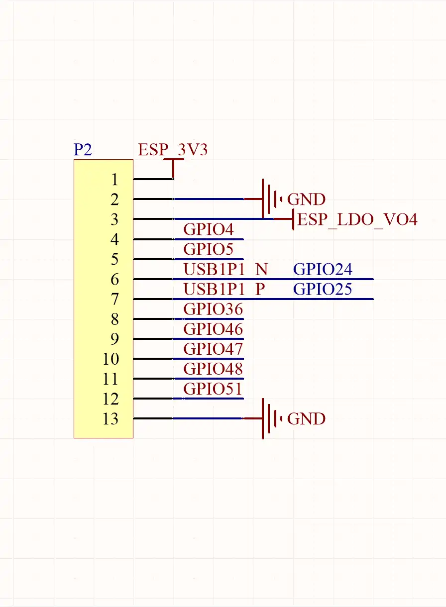
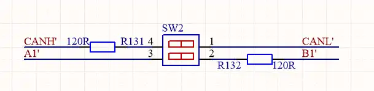
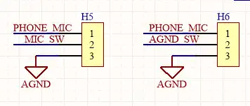
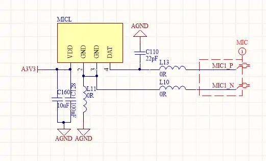
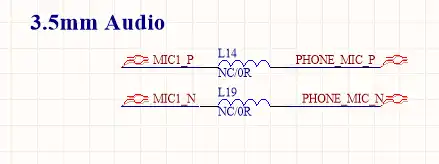
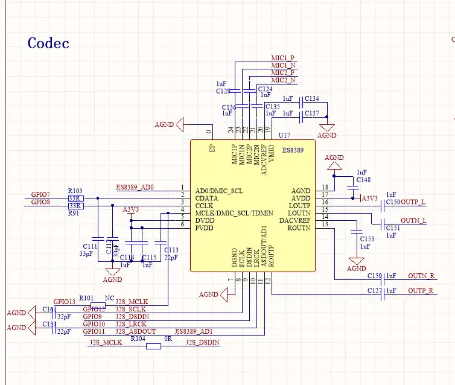

# ESP32-P4-WIFI6-DB-Touch-LCD-7C <!-- omit in toc -->

[简体中文](USER_GUIDE_ZH.md)

This user guide will help you get started with ESP32-P4-WIFI6-DB-Touch-LCD-7C and will also provide more in-depth information.

ESP32-P4-WIFI6-DB-Touch-LCD-7C is a development board built around the ESP32-P4NRW32X processor, paired with an ESP32-C5-MINI-1 wireless coprocessor over SDIO. It integrates a 7-inch 1024 × 600 MIPI-DSI capacitive touch display and provides MIPI-CSI, ES8389 audio, PCF85063A RTC, microSD, USB, TWAI/CAN, RS232, RS485, a BOOT button, user LEDs and a GPIO header.

The document consists of the following major sections:

- [Getting Started](#1-getting-started): Overview of the board, its onboard resources, peripherals and factory firmware.
- [Start Application Development](#2-start-application-development): Hardware and software setup before development.
- [Hardware Reference](#3-hardware-reference): GPIO allocation, headers, connectors, jumpers and usage notes.
- [Related Documents](#4-related-documents): Links to related documentation.

# 1. Getting Started

## 1.1. Overview

The ESP32-P4NRW32X main processor handles the display, camera, audio, storage and communication interfaces. The ESP32-C5-MINI-1 acts as a wireless coprocessor and provides Wi-Fi 6 and Bluetooth LE to the ESP32-P4 through ESP-Hosted (SDIO). The ESP32-P4 has no integrated Wi-Fi or Bluetooth, so wireless features require the P4 application and the C5 coprocessor firmware to run together.

## 1.2. Onboard Resources

The table below lists the key components of the board.

<details open>
<summary><b>Onboard resources table</b></summary>

| Key Component | Description |
| --- | --- |
| Main processor | ESP32-P4NRW32X — dual-core high-performance RISC-V system and a low-power core, with integrated PSRAM. |
| Flash | 32 MB external NOR Flash. |
| Wireless coprocessor | ESP32-C5-MINI-1, supporting 2.4 / 5 GHz Wi-Fi 6 and Bluetooth LE, connected to the ESP32-P4 over four-bit SDIO. ESP32-P4 GPIO54 drives the ESP32-C5-MINI-1 EN pin; ESP32-P4 GPIO6 can be used as the wake-up signal for the ESP32-C5-MINI-1. |
| Programming port | Onboard USB-to-UART bridge connected to ESP32-P4 UART0 (GPIO37/GPIO38) for firmware download and serial logs. |
| USB | USB 2.0 High-Speed port on the ESP32-P4 dedicated USB pins; no GPIOs are used. |
| Display | 7-inch 1024 × 600 landscape panel with EK79007 driver, two-lane MIPI-DSI. LCD reset on GPIO31; backlight enable on GPIO52 and brightness PWM on GPIO30 (active low). |
| Touch | GT911 capacitive touch on the shared GPIO7/GPIO8 I2C bus, reset on GPIO23; interrupt not connected. |
| Audio | ES8389 codec connected over I2S; speaker output through an amplifier enabled by GPIO53; two differential analog microphone inputs (MIC1 connects to an onboard microphone by default and can be switched to the headset microphone by repopulating components; see [Microphone Input Selection](#microphone-input-selection)); four-pole headset jack, US (CTIA) pinout by default, switchable to CN (OMTP) via H5/H6 (see [Headset Standard Selection](#342-headset-standard-selection)). |
| RTC | PCF85063A on the shared I2C bus, interrupt output on GPIO20. |
| Storage | microSD slot over four-bit SDMMC; card power switched by GPIO45 (active low), IO power from on-chip LDO VO4. |
| Camera | Two-lane MIPI-CSI connector with SCCB on the shared I2C bus; XCLK and RESET are not connected to ESP32-P4 GPIOs. |
| TWAI/CAN | Onboard CAN transceiver, TX=GPIO22, RX=GPIO21; 120 Ω termination selectable via SW2 (see [Termination Resistor Selection (SW2)](#341-termination-resistor-selection-sw2)). |
| RS232 | Onboard RS232 transceiver, TX=GPIO28, RX=GPIO29, no hardware flow-control signals. |
| RS485 | Onboard RS485 transceiver, TX=GPIO26, RX=GPIO27, direction control (DE/RE)=GPIO34; 120 Ω termination selectable via SW2. |
| BOOT button | On GPIO35; selects download mode at power-up and can be read as a button input at runtime. |
| User LEDs | Two active-low LEDs on GPIO2 and GPIO3. |
| GPIO headers | P1 (16 pins) and P2 (13 pins), exposing 13 ESP32-P4 GPIOs plus power, RS485, RS232 and CAN terminals. |
| MIPI PHY power | DSI and CSI share on-chip LDO VO3. |
| 32.768 kHz crystal | Y4 on GPIO0/GPIO1 (XTAL_32K_N/P) provides the ESP32-P4 low-speed clock. |

</details>

## 1.3. Peripheral Quick Reference

<details open>
<summary><b>Peripheral quick reference table</b></summary>

| Module | Device / Function | Interface | Address / Parameters | GPIO / Signal |
| --- | --- | --- | --- | --- |
| LCD | EK79007, 1024 × 600 | MIPI-DSI | 2-lane | RST=GPIO31 |
| LCD backlight | Backlight driver | GPIO / PWM | Brightness PWM active low | Enable=GPIO52, PWM=GPIO30 |
| Touch | GT911 capacitive touch | I2C | 7-bit address 0x5D or 0x14 | SDA=GPIO7, SCL=GPIO8; RST=GPIO23; INT not connected |
| Camera | MIPI-CSI camera connector | MIPI-CSI + SCCB | 2-lane | SCCB shares GPIO7/8; XCLK/RESET not connected |
| Audio | ES8389 codec | I2C + I2S | 7-bit address 0x10 | SDA=7, SCL=8; SCLK=12, LRCK=10, DSDIN=9, ASDOUT=11; MCLK not connected by default, codec clocked from SCLK (see [Codec Clock Selection](#codec-clock-selection)) |
| Power amp | Speaker amplifier enable | GPIO | Active high | GPIO53 |
| RTC | PCF85063A | I2C | 7-bit address 0x51 | SDA=GPIO7, SCL=GPIO8; INT=GPIO20 |
| microSD | microSD slot | SDMMC 4-bit | IO power from LDO VO4 | CLK=43, CMD=44, D0–D3=39–42; power enable=45, active low |
| Wi-Fi/BT coprocessor | ESP32-C5-MINI-1 | SDIO 4-bit | — | CLK=18, CMD=19, D0–D3=14–17; EN=54; wake-up=6 |
| USB | USB 2.0 High-Speed | USB | Internal USB 2.0 HS PHY | Dedicated USB pins |
| TWAI/CAN | CAN transceiver | TWAI | — | TX=GPIO22, RX=GPIO21 |
| RS232 | RS232 transceiver | UART | No flow control | TX=GPIO28, RX=GPIO29 |
| RS485 | RS485 transceiver | UART | Half duplex | TX=GPIO26, RX=GPIO27, DE/RE=GPIO34 |
| BOOT button | BOOT | GPIO | Low when pressed | GPIO35 |
| User LEDs | LED1 / LED2 | GPIO | Active low | GPIO2 / GPIO3 |
| UART0 | Programming and serial logs | UART | Onboard USB-to-UART bridge | TX=GPIO37, RX=GPIO38 |

</details>

## 1.4. Factory Firmware

The board ships with an ESP-Brookesia based application firmware featuring display, touch, audio, Wi-Fi and XiaoZhi. For the feature overview, usage and build instructions, see the [factory firmware README](../../examples/factory/README.md).

# 2. Start Application Development

This section describes the hardware you need and the hardware and software setup before development.

## 2.1. Required Hardware

- 1 x ESP32-P4-WIFI6-DB-Touch-LCD-7C
- 1 x USB Type-C cable for power, firmware download and serial logs
- 1 x Computer running Windows, Linux or macOS

## 2.2. Optional Hardware

- 1 x microSD card
- 1 x MIPI-CSI camera module
- 1 x Speaker, or a four-pole 3.5 mm headset
- 1 x [USB TO RS232/485](https://www.waveshare.com/usb-to-rs232-485.htm) converter for testing RS232 / RS485 from a computer
- 1 x [USB-CAN-A](https://www.waveshare.com/usb-can-a.htm) analyzer for testing CAN from a computer

## 2.3. Power Supply Options

The board can be powered in either of the following ways:

- USB Type-C port
- External DC supply on P1 pins DC+ (P1-1) and GNDA (P1-2), input range 7–36 V

> **Note**
>
> Check the polarity before connecting an external supply: DC+ goes to the positive terminal and GNDA to ground.

## 2.4. Hardware Setup

1. Connect the board's USB-to-UART port to your computer with a USB cable.
2. If you use a camera, connect the camera cable with power off and verify connector orientation against the module instructions.
3. If you use CAN or RS485, set [SW2](#341-termination-resistor-selection-sw2) according to the board's position on the bus.
4. If automatic download fails, hold the **BOOT** button while powering up the board to enter download mode.

## 2.5. Software Setup

1. Install ESP-IDF. The local BSP requires ESP-IDF >= 5.5.
2. Build and flash the board check example [00_board_check](../../examples/esp-idf/board_check/):

   ```bash
   cd examples/esp-idf/board_check
   idf.py set-target esp32p4
   idf.py build
   idf.py -p PORT flash monitor
   ```

   Replace `PORT` with the actual serial port, for example `COMx` on Windows or `/dev/ttyACM0` on Linux.

3. Once the board check passes, continue with the [ESP-IDF examples](../../examples/esp-idf/) or [Arduino examples](../../examples/arduino/examples/).

# 3. Hardware Reference

This section provides more detailed information about the board hardware.

## 3.1. GPIO Allocation

The table lists every GPIO (0–54) and its board connection.

<details open>
<summary><b>GPIO allocation table (GPIO0–GPIO54)</b></summary>

| GPIO | Signal | Connected To | Notes |
| --- | --- | --- | --- |
| GPIO0 | XTAL_32K_N | 32.768 kHz crystal Y4 | 22 pF load capacitor; 10 MΩ resistor across GPIO0–GPIO1 |
| GPIO1 | XTAL_32K_P | 32.768 kHz crystal Y4 | 22 pF load capacitor; 10 MΩ resistor across GPIO0–GPIO1 |
| GPIO2 | LED_USER1 | User LED 1 | Active low |
| GPIO3 | LED_USER2 | User LED 2 | Active low |
| GPIO4 | GPIO4 | Header P2-4 | Configurable as general-purpose GPIO |
| GPIO5 | GPIO5 | Header P2-5 | Configurable as general-purpose GPIO |
| GPIO6 | C5_WAKEUP | ESP32-C5-MINI-1 | ESP32-P4 GPIO6 can be used as the wake-up signal for the ESP32-C5-MINI-1 |
| GPIO7 | I2C SDA | ES8389, GT911, PCF85063A, camera SCCB | Shared I2C bus |
| GPIO8 | I2C SCL | ES8389, GT911, PCF85063A, camera SCCB | Shared I2C bus |
| GPIO9 | I2S DOUT | ES8389 DSDIN | Playback data, ESP32-P4 → codec |
| GPIO10 | I2S WS | ES8389 LRCK | Audio frame sync |
| GPIO11 | I2S DIN | ES8389 ASDOUT | Capture data, codec → ESP32-P4 |
| GPIO12 | I2S SCLK | ES8389 SCLK | Audio bit clock |
| GPIO13 | GPIO13 | ES8389 MCLK through R101 | R101 is not populated by default, so GPIO13 is not connected to the codec; see [Codec Clock Selection](#codec-clock-selection) |
| GPIO14 | SDIO D0 | ESP32-C5-MINI-1 | SDIO data line |
| GPIO15 | SDIO D1 | ESP32-C5-MINI-1 | SDIO data line |
| GPIO16 | SDIO D2 | ESP32-C5-MINI-1 | SDIO data line |
| GPIO17 | SDIO D3 | ESP32-C5-MINI-1 | SDIO data line |
| GPIO18 | SDIO CLK | ESP32-C5-MINI-1 | SDIO clock |
| GPIO19 | SDIO CMD | ESP32-C5-MINI-1 | SDIO command |
| GPIO20 | RTC_INT | PCF85063A INT | RTC interrupt input |
| GPIO21 | CAN RX | CAN transceiver | Transceiver → ESP32-P4 |
| GPIO22 | CAN TX | CAN transceiver | ESP32-P4 → transceiver |
| GPIO23 | TP_RST | GT911 reset | Touch controller reset |
| GPIO24 | GPIO24 / USB1P1_N | Header P2-6 | USB 1.1 Full-Speed PHY alternate function |
| GPIO25 | GPIO25 / USB1P1_P | Header P2-7 | USB 1.1 Full-Speed PHY alternate function |
| GPIO26 | RS485 TX | RS485 transceiver | ESP32-P4 → transceiver |
| GPIO27 | RS485 RX | RS485 transceiver | Transceiver → ESP32-P4 |
| GPIO28 | RS232 TX | RS232 transceiver | ESP32-P4 → transceiver |
| GPIO29 | RS232 RX | RS232 transceiver | Transceiver → ESP32-P4 |
| GPIO30 | LCD_BL_PWM | LCD backlight | Brightness PWM, active low |
| GPIO31 | LCD_RST | EK79007 reset | LCD reset |
| GPIO32 | GPIO32 | Header P1-6 | Configurable as general-purpose GPIO |
| GPIO33 | GPIO33 | Header P1-7 | Configurable as general-purpose GPIO |
| GPIO34 | RS485 DE/RE | RS485 transceiver | Direction control; strapping pin |
| GPIO35 | BOOT | BOOT button | Button detection; strapping pin (boot mode) |
| GPIO36 | GPIO36 | Header P2-8 | Strapping pin, pulled up to 3.3 V by default |
| GPIO37 | UART0 TX | USB-to-UART bridge | Firmware download and serial logs; strapping pin |
| GPIO38 | UART0 RX | USB-to-UART bridge | Firmware download and serial logs; strapping pin |
| GPIO39 | SD D0 | microSD card | SDMMC data line |
| GPIO40 | SD D1 | microSD card | SDMMC data line |
| GPIO41 | SD D2 | microSD card | SDMMC data line |
| GPIO42 | SD D3 | microSD card | SDMMC data line |
| GPIO43 | SD CLK | microSD card | SDMMC clock |
| GPIO44 | SD CMD | microSD card | SDMMC command |
| GPIO45 | SD_VDD_EN | microSD power switch | Active low |
| GPIO46 | GPIO46 | Header P2-9 | Configurable as general-purpose GPIO |
| GPIO47 | GPIO47 | Header P2-10 | Configurable as general-purpose GPIO |
| GPIO48 | GPIO48 | Header P2-11 | Configurable as general-purpose GPIO |
| GPIO49 | GPIO49 | Header P1-8 | Configurable as general-purpose GPIO |
| GPIO50 | GPIO50 | Header P1-9 | Configurable as general-purpose GPIO |
| GPIO51 | GPIO51 | Header P2-12 | Configurable as general-purpose GPIO |
| GPIO52 | LCD_BL_EN | LCD backlight | Backlight enable |
| GPIO53 | PA_CTRL | Speaker amplifier | Active high |
| GPIO54 | C5_EN | ESP32-C5-MINI-1 EN | High enables; low resets |

</details>

## 3.2. GPIO Header

The board has two headers, P1 (16 pins) and P2 (13 pins), exposing 13 ESP32-P4 GPIOs in total:

- **P1**: external power input, RS485, RS232 and CAN terminals, plus 4 GPIOs (GPIO32/33/49/50).
- **P2**: 3.3 V and LDO VO4 power, plus 9 GPIOs (GPIO4/5/24/25/36/46/47/48/51).

<details open>
<summary><b>P1 Header (16 Pins)</b></summary>

<table>
  <tr>
    <td valign="middle"></td>
    <td valign="middle">
      <table>
        <tr><th>Pin</th><th>Signal</th><th>Type</th><th>Description</th></tr>
        <tr><td align="center">1</td><td>DC+</td><td>Power</td><td>External power input + (7–36 V)</td></tr>
        <tr><td align="center">2</td><td>GNDA</td><td>Power</td><td>External power ground</td></tr>
        <tr><td align="center">3</td><td>5V</td><td>Power</td><td>5 V power</td></tr>
        <tr><td align="center">4</td><td>GND</td><td>Power</td><td>Ground</td></tr>
        <tr><td align="center">5</td><td>3V3</td><td>Power</td><td>3.3 V power</td></tr>
        <tr><td align="center">6</td><td>GPIO32</td><td>GPIO</td><td>General-purpose IO</td></tr>
        <tr><td align="center">7</td><td>GPIO33</td><td>GPIO</td><td>General-purpose IO</td></tr>
        <tr><td align="center">8</td><td>GPIO49</td><td>GPIO</td><td>General-purpose IO</td></tr>
        <tr><td align="center">9</td><td>GPIO50</td><td>GPIO</td><td>General-purpose IO</td></tr>
        <tr><td align="center">10</td><td>RS485 A</td><td>RS485</td><td>Differential line A</td></tr>
        <tr><td align="center">11</td><td>RS485 B</td><td>RS485</td><td>Differential line B</td></tr>
        <tr><td align="center">12</td><td>RS232 TX</td><td>RS232</td><td>Transmit</td></tr>
        <tr><td align="center">13</td><td>RS232 RX</td><td>RS232</td><td>Receive</td></tr>
        <tr><td align="center">14</td><td>GND</td><td>Power</td><td>Ground</td></tr>
        <tr><td align="center">15</td><td>CANH</td><td>CAN</td><td>CAN bus high</td></tr>
        <tr><td align="center">16</td><td>CANL</td><td>CAN</td><td>CAN bus low</td></tr>
      </table>
    </td>
  </tr>
</table>

</details>

<details open>
<summary><b>P2 Header (13 Pins)</b></summary>

<table>
  <tr>
    <td valign="middle"></td>
    <td valign="middle">
      <table>
        <tr><th>Pin</th><th>Signal</th><th>Type</th><th>Description</th></tr>
        <tr><td align="center">1</td><td>3V3</td><td>Power</td><td>3.3 V power</td></tr>
        <tr><td align="center">2</td><td>GND</td><td>Power</td><td>Ground</td></tr>
        <tr><td align="center">3</td><td>ESP_LDO_VO4</td><td>Power</td><td>On-chip LDO VO4 output</td></tr>
        <tr><td align="center">4</td><td>GPIO4</td><td>GPIO</td><td>General-purpose IO</td></tr>
        <tr><td align="center">5</td><td>GPIO5</td><td>GPIO</td><td>General-purpose IO</td></tr>
        <tr><td align="center">6</td><td>GPIO24</td><td>GPIO</td><td>General-purpose IO, alternate function USB1P1_N</td></tr>
        <tr><td align="center">7</td><td>GPIO25</td><td>GPIO</td><td>General-purpose IO, alternate function USB1P1_P</td></tr>
        <tr><td align="center">8</td><td>GPIO36</td><td>GPIO</td><td>General-purpose IO; strapping pin, pulled up to 3.3 V by default</td></tr>
        <tr><td align="center">9</td><td>GPIO46</td><td>GPIO</td><td>General-purpose IO</td></tr>
        <tr><td align="center">10</td><td>GPIO47</td><td>GPIO</td><td>General-purpose IO</td></tr>
        <tr><td align="center">11</td><td>GPIO48</td><td>GPIO</td><td>General-purpose IO</td></tr>
        <tr><td align="center">12</td><td>GPIO51</td><td>GPIO</td><td>General-purpose IO</td></tr>
        <tr><td align="center">13</td><td>GND</td><td>Power</td><td>Ground</td></tr>
      </table>
    </td>
  </tr>
</table>

</details>

## 3.3. Camera and Display Connectors

The camera SCCB interface, GT911 touch controller, ES8389 and PCF85063A share I2C on GPIO7/GPIO8. The LCD backlight is controlled by dedicated GPIOs (enable GPIO52, PWM GPIO30), not over I2C.

| Connector | Interface | ESP32-P4 signals |
| --- | --- | --- |
| Camera | MIPI-CSI | Two data lanes, clock lane, shared I2C; XCLK/RESET not connected |
| Display | MIPI-DSI | Two data lanes, clock lane, LCD RST=GPIO31, backlight enable=GPIO52, backlight PWM=GPIO30, touch I2C + RST=GPIO23; touch INT not connected |

## 3.4. Jumpers and Switches

The board has the following switches and pads that you may need to set manually for your use case.

### 3.4.1. Termination Resistor Selection (SW2)

SW2 is a 2-position DIP switch that connects the 120 Ω termination resistors for the CAN and RS485 buses. The two positions are independent and can be switched separately. Both positions are OFF by default, so no termination is connected out of the box.

<center>

|  |
|:--:|
| Termination resistor DIP switch SW2 |

</center>

| Position | Switch pins | Bus | When set to ON |
| :---: | :---: | --- | --- |
| 1 | 4–1 | CAN | Connects CANH and CANL through R131 (120 Ω) |
| 2 | 3–2 | RS485 | Connects A and B through R132 (120 Ω) |

- Termination is only needed at the two ends of a bus. Set the switch to ON when the board is at the end of the bus, and OFF when it sits in the middle.
- On very short buses (for example two nodes with a short cable) termination can be omitted; if you see bit errors or ringing, check that termination is set correctly.

### 3.4.2. Headset Standard Selection

The headset jack supports both the US (CTIA) and CN (OMTP) four-pole pinouts. Pads H5 and H6 select where the microphone and ground are routed. The factory default is US.

<center>

|  |
|:--:|
| Headset standard selection pads H5 / H6 |

</center>

| Standard | H5 connection | H6 connection | Description |
| --- | --- | --- | --- |
| US (default) | 1–2: MIC_SW to PHONE_MIC | 2–3: AGND_SW to AGND | MIC_SW connects to the headset microphone PHONE_MIC; AGND_SW connects to ground |
| CN | 2–3: MIC_SW to AGND | 1–2: AGND_SW to PHONE_MIC | MIC_SW connects to ground; AGND_SW connects to the headset microphone PHONE_MIC |

- To use a CN-standard headset, change both H5 and H6; do not change only one of them.
- The headset microphone reaches the ES8389 only when MIC1 is populated for the headset input; see [Microphone Input Selection](#microphone-input-selection).

<a id="microphone-input-selection"></a>

### 3.4.3. Microphone Input Selection (L10 / L13 / L14 / L19)

The ES8389 has only two differential microphone inputs, MIC1 and MIC2. MIC2 is always connected to an onboard microphone. MIC1 is shared between an onboard microphone and the headset microphone, and component population selects which one is connected. By default MIC1 connects to the onboard microphone.

<center>

|  |  |
|:--:|:--:|
| MIC1 onboard microphone input (L10 / L13) | MIC1 headset microphone input (L14 / L19) |

</center>

| MIC1 source | Populate | Leave unpopulated | Description |
| --- | --- | --- | --- |
| Onboard microphone (default) | L10, L13 | L14, L19 | MIC1 and MIC2 are both onboard microphones, usable for dual-mic capture |
| Headset microphone | L14, L19 | L10, L13 | MIC1 is the headset microphone; MIC2 remains an onboard microphone |

- Populate only one of the two groups. If both are populated, the onboard and headset microphones are connected in parallel on MIC1, so their signals mix and their bias circuits interfere.
- In software, MIC1 is the ADC left channel (FL) and MIC2 is the right channel (FR). With the headset microphone selected, use the left channel to record only from the headset.
- No headset-detect signal is routed to a GPIO, so software cannot tell whether a headset is inserted; the MIC1 source is fixed by component population.

<a id="codec-clock-selection"></a>

### 3.4.4. Codec Clock Selection (R101 / R104)

The ES8389 pin 4 (MCLK/DMIC_SCL/TDMIN) is routed to the I2S_MCLK net, which can be connected either to ESP32-P4 GPIO13 or to the I2S_DSDIN net (GPIO9) through two resistor options. By default the codec does not receive a master clock and derives its internal clock from SCLK.

<center>

|  |
|:--:|
| ES8389 codec schematic |

</center>

| Configuration | R101 (GPIO13 – I2S_MCLK) | R104 (I2S_MCLK – I2S_DSDIN) | Codec clock source |
| --- | --- | --- | --- |
| Default | Not populated (NC) | 0 Ω | Derived from SCLK; ES8389 pin 4 is tied to DSDIN |
| External MCLK | 0 Ω | Not populated | MCLK from GPIO13 |

- With the default configuration, configure the ES8389 driver without MCLK (`use_mclk = false` in `es8389_codec_cfg_t`) and do not output MCLK on GPIO13.
- Without MCLK, the ES8389 driver supports only 8 kHz, 16 kHz, 44.1 kHz and 48 kHz with 16-bit or 32-bit stereo I2S. Other sample rates, such as 22.05 kHz or 24 kHz, leave the codec unclocked; resample audio to a supported rate first.
- To use GPIO13 as MCLK, populate R101 and remove R104; never populate both, or GPIO13 and GPIO9 are shorted together.

## 3.5. Usage Notes

- The GPIO7/8 I2C bus already carries ES8389 (0x10), GT911 (0x5D/0x14), PCF85063A (0x51) and camera SCCB; avoid address conflicts when adding external I2C devices.
- By default the ES8389 has no MCLK and runs only at 8/16/44.1/48 kHz; see [Codec Clock Selection](#codec-clock-selection).
- GPIO0/GPIO1 are connected to the 32.768 kHz crystal and cannot be used as general-purpose GPIOs.
- GPIO6, GPIO20, GPIO23, GPIO30, GPIO31, GPIO45, GPIO52, GPIO53 and GPIO54 carry control signals for onboard peripherals; do not connect other circuits to them.
- GPIO34–GPIO38 are ESP32-P4 strapping pins. GPIO34 drives RS485 direction control, GPIO35 is the BOOT button (hold at power-up for download mode), and GPIO36 is on P2-8 with a default pull-up to 3.3 V; make sure external circuits do not pull it low at power-up. GPIO37/38 are used for programming and logs.
- GPIO24/25 have the USB 1.1 Full-Speed PHY alternate function; make sure that PHY is not enabled before using them as GPIOs.
- GPIO39–GPIO48 are powered by on-chip LDO VO4; the microSD IO level depends on this supply.
- Connect display/camera cables with power off and verify connector orientation against the module instructions.

# 4. Related Documents

## 4.1. Datasheets

- [ESP32-P4 Datasheet](https://www.espressif.com/sites/default/files/documentation/esp32-p4_datasheet_en.pdf) (PDF)
- [ESP32-C5 Datasheet](https://www.espressif.com/sites/default/files/documentation/esp32-c5_datasheet_en.pdf) (PDF)
- [ESP32-C5-MINI-1 Datasheet](https://www.espressif.com/sites/default/files/documentation/esp32-c5-mini-1_mini-1u_datasheet_en.pdf) (PDF)

## 4.2. Schematics and Dimensions

Board outline, mounting holes and schematics are published in the [official documentation](https://docs.waveshare.net/ESP32-P4-WIFI6-DB-Touch-LCD-7C).

## 4.3. Software Resources

- [Hardware test firmware](../../examples/esp-idf/hw_console/README.md)

## 4.4. Product Page

- [Product page](https://www.waveshare.net/shop/ESP32-P4-WIFI6-DB-Touch-LCD-7C.htm)
