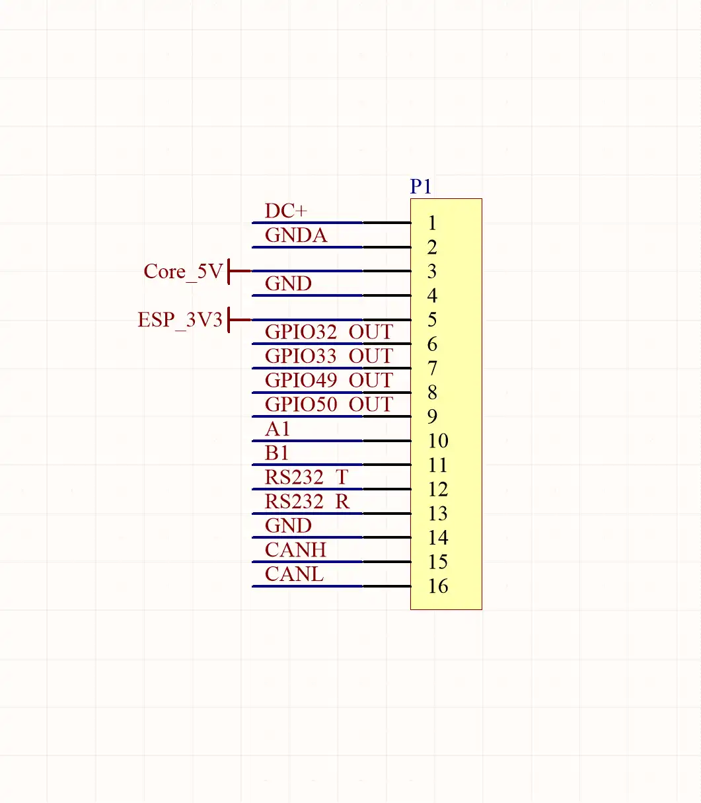
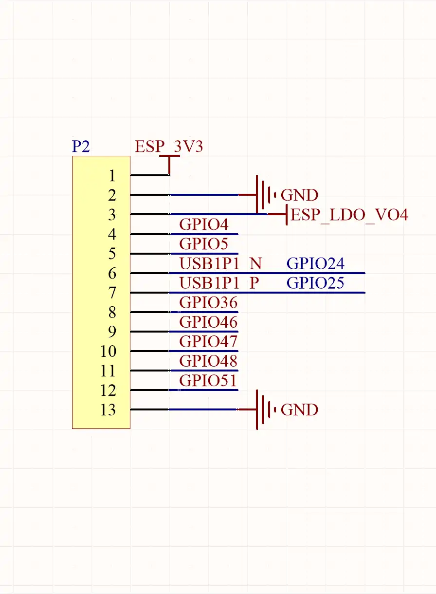
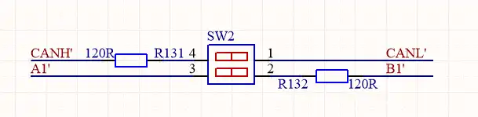
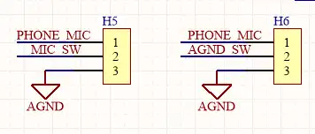
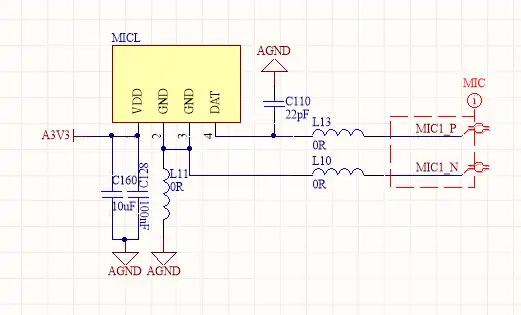
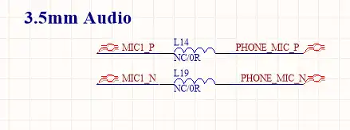
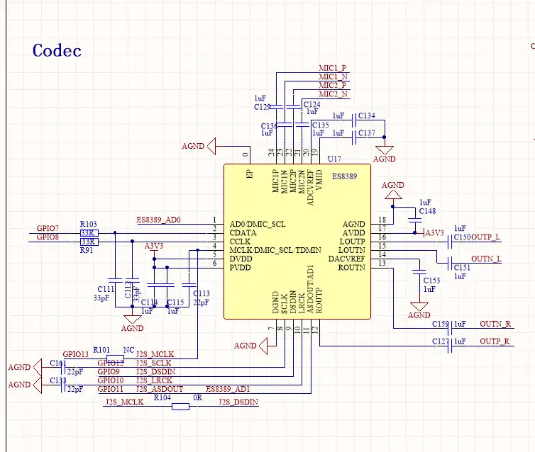

# ESP32-P4-WIFI6-DB-Touch-LCD-7C <!-- omit in toc -->

[English](USER_GUIDE.md)

本指南将帮助您快速上手 ESP32-P4-WIFI6-DB-Touch-LCD-7C，并提供该款开发板的详细信息。

ESP32-P4-WIFI6-DB-Touch-LCD-7C 是一款以 ESP32-P4NRW32X 为主处理器、搭配 ESP32-C5-MINI-1 无线协处理器的开发板，两者通过 SDIO 连接。板载 7 英寸 1024 × 600 MIPI-DSI 电容触摸屏，并提供 MIPI-CSI、ES8389 音频、PCF85063A 实时时钟、microSD、USB、TWAI/CAN、RS232、RS485、BOOT 按键、用户 LED 和 GPIO 排针。

本指南包括如下内容：

- [入门指南](#1-入门指南)：介绍开发板的概况、板载资源、外设和出厂固件。
- [开始开发应用](#2-开始开发应用)：说明开发前需要的硬件和软件设置。
- [硬件参考](#3-硬件参考)：详细介绍 GPIO 分配、排针、接口、跳线和使用注意事项。
- [相关文档](#4-相关文档)：列出相关文档的链接。

# 1. 入门指南

## 1.1. 概述

ESP32-P4NRW32X 主处理器负责显示、摄像头、音频、存储和各类通信接口；ESP32-C5-MINI-1 作为无线协处理器，通过 ESP-Hosted（SDIO）为 ESP32-P4 提供 Wi-Fi 6 和 Bluetooth LE。ESP32-P4 本身不集成 Wi-Fi 或蓝牙，无线功能需要 P4 应用与 C5 协处理器固件配合运行。

## 1.2. 板载资源

下表列出开发板上的主要组件。

<details open>
<summary><b>板载资源表</b></summary>

| 主要组件 | 介绍 |
| --- | --- |
| 主处理器 | ESP32-P4NRW32X，双核高性能 RISC-V 系统与单核低功耗系统，集成 PSRAM。 |
| Flash | 32 MB 外置 NOR Flash。 |
| 无线协处理器 | ESP32-C5-MINI-1，支持 2.4 / 5 GHz Wi-Fi 6 和 Bluetooth LE，通过四位 SDIO 与 ESP32-P4 相连；ESP32-C5-MINI-1 的 EN 由 ESP32-P4 GPIO54 控制，ESP32-P4 GPIO6 可用作 ESP32-C5-MINI-1 的唤醒信号。 |
| 下载接口 | 板载 USB 转串口，连接 ESP32-P4 UART0（GPIO37/GPIO38），用于固件下载和串口日志。 |
| USB | USB 2.0 高速接口，使用 ESP32-P4 专用 USB 引脚，不占用 GPIO。 |
| 显示 | 7 英寸 1024 × 600 横屏，EK79007 驱动，双通道 MIPI-DSI。LCD 复位接 GPIO31，背光使能接 GPIO52，背光亮度 PWM 接 GPIO30（低电平有效）。 |
| 触摸 | GT911 电容触摸，挂在 GPIO7/GPIO8 共享 I2C 总线上，复位接 GPIO23，中断未连接。 |
| 音频 | ES8389 编解码器，I2S 连接 ESP32-P4；扬声器输出经功放，功放使能接 GPIO53；两路差分模拟麦克风输入（MIC1 默认接板载咪头，可改贴为耳机麦克风，详见[麦克风输入选择](#microphone-input-selection)）；四段耳机接口，默认 US（CTIA）线序，可通过 H5/H6 切换为 CN（OMTP），详见[耳机接口标准选择](#342-耳机接口标准选择)。 |
| 实时时钟 | PCF85063A，挂在共享 I2C 总线上，中断输出接 GPIO20。 |
| 存储 | microSD 卡座，四位 SDMMC 连接；卡电源由 GPIO45 控制（低电平使能），IO 电源来自片上 LDO VO4。 |
| 摄像头 | 双通道 MIPI-CSI 接口，SCCB 挂在共享 I2C 总线上；XCLK 和 RESET 未连接 ESP32-P4 GPIO。 |
| TWAI/CAN | 板载 CAN 收发器，TX=GPIO22，RX=GPIO21；120 Ω 终端电阻可通过 SW2 接入，详见[终端电阻选择（SW2）](#341-终端电阻选择sw2)。 |
| RS232 | 板载 RS232 收发器，TX=GPIO28，RX=GPIO29，无硬件流控信号。 |
| RS485 | 板载 RS485 收发器，TX=GPIO26，RX=GPIO27，收发方向控制（DE/RE）=GPIO34；120 Ω 终端电阻可通过 SW2 接入。 |
| BOOT 按键 | 接 GPIO35，用于上电时进入下载模式，运行时也可作为按键输入检测。 |
| 用户 LED | 两颗低电平点亮的 LED，分别接 GPIO2 和 GPIO3。 |
| GPIO 排针 | P1（16 Pin）和 P2（13 Pin），共引出 13 个 ESP32-P4 GPIO，以及电源、RS485、RS232 和 CAN 接线端。 |
| MIPI PHY 电源 | DSI 与 CSI 共用片上 LDO VO3。 |
| 32.768 kHz 晶振 | Y4 接 GPIO0/GPIO1（XTAL_32K_N/P），为 ESP32-P4 提供低速时钟。 |

</details>

## 1.3. 外设速查

<details open>
<summary><b>外设速查表</b></summary>

| 模块 | 器件 / 功能 | 接口 | 地址 / 参数 | GPIO / 信号 |
| --- | --- | --- | --- | --- |
| LCD | EK79007，1024 × 600 | MIPI-DSI | 双通道 | RST=GPIO31 |
| LCD 背光 | 背光驱动 | GPIO / PWM | 亮度 PWM 低电平有效 | 使能=GPIO52，PWM=GPIO30 |
| 触摸 | GT911 电容触摸 | I2C | 7 位地址 0x5D 或 0x14 | SDA=GPIO7，SCL=GPIO8；RST=GPIO23；INT 未连接 |
| 摄像头 | MIPI-CSI 摄像头接口 | MIPI-CSI + SCCB | 双通道 | SCCB 共用 GPIO7/8；XCLK/RESET 未连接 |
| 音频 | ES8389 编解码器 | I2C + I2S | 7 位地址 0x10 | SDA=7，SCL=8；SCLK=12，LRCK=10，DSDIN=9，ASDOUT=11；默认不接 MCLK，编解码器时钟由 SCLK 派生（详见[编解码器时钟选择](#codec-clock-selection)） |
| 功放 | 扬声器功放使能 | GPIO | 高电平有效 | GPIO53 |
| RTC | PCF85063A | I2C | 7 位地址 0x51 | SDA=GPIO7，SCL=GPIO8；INT=GPIO20 |
| microSD | microSD 卡座 | SDMMC 4 位 | IO 电源来自 LDO VO4 | CLK=43，CMD=44，D0–D3=39–42；电源使能=45，低电平有效 |
| Wi-Fi/BT 协处理器 | ESP32-C5-MINI-1 | SDIO 4 位 | — | CLK=18，CMD=19，D0–D3=14–17；EN=54；唤醒=6 |
| USB | USB 2.0 高速 | USB | 片内 USB 2.0 高速 PHY | 专用 USB 引脚 |
| TWAI/CAN | CAN 收发器 | TWAI | — | TX=GPIO22，RX=GPIO21 |
| RS232 | RS232 收发器 | UART | 无流控 | TX=GPIO28，RX=GPIO29 |
| RS485 | RS485 收发器 | UART | 半双工 | TX=GPIO26，RX=GPIO27，DE/RE=GPIO34 |
| BOOT 按键 | BOOT | GPIO | 按下为低电平 | GPIO35 |
| 用户 LED | LED1 / LED2 | GPIO | 低电平点亮 | GPIO2 / GPIO3 |
| UART0 | 下载与串口日志 | UART | 板载 USB 转串口 | TX=GPIO37，RX=GPIO38 |

</details>

## 1.4. 出厂固件

开发板出厂预装基于 ESP-Brookesia 的综合应用固件，包含显示、触摸、音频、Wi-Fi 和小智等功能。固件功能介绍、使用方法和编译说明请参阅[出厂固件 README](../../examples/factory/README_ZH.md)。

# 2. 开始开发应用

本小节介绍开始开发前需要准备的硬件，以及硬件和软件设置。

## 2.1. 必备硬件

- 1 块 ESP32-P4-WIFI6-DB-Touch-LCD-7C 开发板
- 1 根 USB Type-C 数据线，用于供电、下载固件和查看串口日志
- 1 台电脑（Windows、Linux 或 macOS）

## 2.2. 可选硬件

- 1 张 microSD 卡
- 1 个 MIPI-CSI 摄像头模组
- 1 个扬声器，或 1 副四段 3.5 mm 耳机
- 1 个 [USB TO RS232/485](https://www.waveshare.net/shop/USB-TO-RS232-485.htm) 转换器，用于在电脑上调试 RS232 / RS485
- 1 个 [USB-CAN-A](https://www.waveshare.net/shop/USB-CAN-A.htm) 分析仪，用于在电脑上调试 CAN

## 2.3. 电源选项

开发板有两种供电方式：

- USB Type-C 接口供电
- 外部直流电源供电：接 P1 排针的 DC+（P1-1）和 GNDA（P1-2），输入电压范围 7–36 V

> **注意**
>
> 外部电源接入前请确认正负极，DC+ 接电源正极，GNDA 接电源地。

## 2.4. 硬件设置

1. 使用 USB 数据线连接开发板的 USB 转串口接口与电脑。
2. 如需使用摄像头，请在断电状态下连接摄像头排线，并按模组说明确认排线方向。
3. 如需使用 CAN 或 RS485，请根据开发板在总线中的位置设置 [SW2](#341-终端电阻选择sw2)。
4. 如果自动下载失败，可按住 **BOOT** 键再给开发板上电，进入下载模式。

## 2.5. 软件设置

1. 安装 ESP-IDF。本地 BSP 要求 ESP-IDF >= 5.5。
2. 编译并烧录开发板检查示例 [00_board_check](../../examples/esp-idf/board_check/)：

   ```bash
   cd examples/esp-idf/board_check
   idf.py set-target esp32p4
   idf.py build
   idf.py -p PORT flash monitor
   ```

   将 `PORT` 替换为实际串口号，例如 Windows 上的 `COMx` 或 Linux 上的 `/dev/ttyACM0`。

3. 开发板检查通过后，可继续运行 [ESP-IDF 示例](../../examples/esp-idf/) 或 [Arduino 示例](../../examples/arduino/examples/)。

# 3. 硬件参考

本小节介绍有关开发板硬件的更多信息。

## 3.1. GPIO 分配

下表列出全部 GPIO（0–54）及其板上连接。

<details open>
<summary><b>GPIO 分配表（GPIO0–GPIO54）</b></summary>

| GPIO | 信号 | 连接对象 | 说明 |
| --- | --- | --- | --- |
| GPIO0 | XTAL_32K_N | 32.768 kHz 晶振 Y4 | 外接 22 pF 负载电容，与 GPIO1 间并联 10 MΩ 电阻 |
| GPIO1 | XTAL_32K_P | 32.768 kHz 晶振 Y4 | 外接 22 pF 负载电容，与 GPIO0 间并联 10 MΩ 电阻 |
| GPIO2 | LED_USER1 | 用户 LED 1 | 低电平点亮 |
| GPIO3 | LED_USER2 | 用户 LED 2 | 低电平点亮 |
| GPIO4 | GPIO4 | 排针 P2-4 | 可配置为通用 GPIO |
| GPIO5 | GPIO5 | 排针 P2-5 | 可配置为通用 GPIO |
| GPIO6 | C5_WAKEUP | ESP32-C5-MINI-1 | ESP32-P4 GPIO6 可用作 ESP32-C5-MINI-1 的唤醒信号 |
| GPIO7 | I2C SDA | ES8389、GT911、PCF85063A、摄像头 SCCB | 共享 I2C 总线 |
| GPIO8 | I2C SCL | ES8389、GT911、PCF85063A、摄像头 SCCB | 共享 I2C 总线 |
| GPIO9 | I2S DOUT | ES8389 DSDIN | 播放数据，ESP32-P4 → 编解码器 |
| GPIO10 | I2S WS | ES8389 LRCK | 音频帧同步 |
| GPIO11 | I2S DIN | ES8389 ASDOUT | 录音数据，编解码器 → ESP32-P4 |
| GPIO12 | I2S SCLK | ES8389 SCLK | 音频位时钟 |
| GPIO13 | GPIO13 | 经 R101 接 ES8389 MCLK | R101 默认不焊，GPIO13 不连接编解码器，详见[编解码器时钟选择](#codec-clock-selection) |
| GPIO14 | SDIO D0 | ESP32-C5-MINI-1 | SDIO 数据线 |
| GPIO15 | SDIO D1 | ESP32-C5-MINI-1 | SDIO 数据线 |
| GPIO16 | SDIO D2 | ESP32-C5-MINI-1 | SDIO 数据线 |
| GPIO17 | SDIO D3 | ESP32-C5-MINI-1 | SDIO 数据线 |
| GPIO18 | SDIO CLK | ESP32-C5-MINI-1 | SDIO 时钟 |
| GPIO19 | SDIO CMD | ESP32-C5-MINI-1 | SDIO 命令 |
| GPIO20 | RTC_INT | PCF85063A INT | RTC 中断输入 |
| GPIO21 | CAN RX | CAN 收发器 | 收发器 → ESP32-P4 |
| GPIO22 | CAN TX | CAN 收发器 | ESP32-P4 → 收发器 |
| GPIO23 | TP_RST | GT911 复位 | 触摸控制器复位 |
| GPIO24 | GPIO24 / USB1P1_N | 排针 P2-6 | USB 1.1 全速 PHY 复用 |
| GPIO25 | GPIO25 / USB1P1_P | 排针 P2-7 | USB 1.1 全速 PHY 复用 |
| GPIO26 | RS485 TX | RS485 收发器 | ESP32-P4 → 收发器 |
| GPIO27 | RS485 RX | RS485 收发器 | 收发器 → ESP32-P4 |
| GPIO28 | RS232 TX | RS232 收发器 | ESP32-P4 → 收发器 |
| GPIO29 | RS232 RX | RS232 收发器 | 收发器 → ESP32-P4 |
| GPIO30 | LCD_BL_PWM | LCD 背光 | 亮度 PWM，低电平有效 |
| GPIO31 | LCD_RST | EK79007 复位 | LCD 复位 |
| GPIO32 | GPIO32 | 排针 P1-6 | 可配置为通用 GPIO |
| GPIO33 | GPIO33 | 排针 P1-7 | 可配置为通用 GPIO |
| GPIO34 | RS485 DE/RE | RS485 收发器 | 收发方向控制；Strapping 引脚 |
| GPIO35 | BOOT | BOOT 按键 | 按键检测；Strapping 引脚（启动模式） |
| GPIO36 | GPIO36 | 排针 P2-8 | Strapping 引脚，默认上拉到 3.3V |
| GPIO37 | UART0 TX | USB 转串口 | 固件下载与串口日志；Strapping 引脚 |
| GPIO38 | UART0 RX | USB 转串口 | 固件下载与串口日志；Strapping 引脚 |
| GPIO39 | SD D0 | microSD 卡 | SDMMC 数据线 |
| GPIO40 | SD D1 | microSD 卡 | SDMMC 数据线 |
| GPIO41 | SD D2 | microSD 卡 | SDMMC 数据线 |
| GPIO42 | SD D3 | microSD 卡 | SDMMC 数据线 |
| GPIO43 | SD CLK | microSD 卡 | SDMMC 时钟 |
| GPIO44 | SD CMD | microSD 卡 | SDMMC 命令 |
| GPIO45 | SD_VDD_EN | microSD 电源开关 | 低电平使能 |
| GPIO46 | GPIO46 | 排针 P2-9 | 可配置为通用 GPIO |
| GPIO47 | GPIO47 | 排针 P2-10 | 可配置为通用 GPIO |
| GPIO48 | GPIO48 | 排针 P2-11 | 可配置为通用 GPIO |
| GPIO49 | GPIO49 | 排针 P1-8 | 可配置为通用 GPIO |
| GPIO50 | GPIO50 | 排针 P1-9 | 可配置为通用 GPIO |
| GPIO51 | GPIO51 | 排针 P2-12 | 可配置为通用 GPIO |
| GPIO52 | LCD_BL_EN | LCD 背光 | 背光使能 |
| GPIO53 | PA_CTRL | 扬声器功放 | 高电平使能 |
| GPIO54 | C5_EN | ESP32-C5-MINI-1 EN | 高电平使能，低电平复位 |

</details>

## 3.2. GPIO 排针

板上有 P1（16 Pin）和 P2（13 Pin）两组排针，共引出 13 个 ESP32-P4 GPIO：

- **P1**：外部供电、RS485、RS232、CAN 接线端，以及 4 个 GPIO（GPIO32/33/49/50）。
- **P2**：3.3V / LDO VO4 电源，以及 9 个 GPIO（GPIO4/5/24/25/36/46/47/48/51）。

<details open>
<summary><b>P1 排针（16 Pin）</b></summary>

<table>
  <tr>
    <td valign="middle"></td>
    <td valign="middle">
      <table>
        <tr><th>引脚</th><th>信号</th><th>类型</th><th>说明</th></tr>
        <tr><td align="center">1</td><td>DC+</td><td>电源</td><td>外部电源输入正极（7–36 V）</td></tr>
        <tr><td align="center">2</td><td>GNDA</td><td>电源</td><td>外部电源地</td></tr>
        <tr><td align="center">3</td><td>5V</td><td>电源</td><td>5V 电源</td></tr>
        <tr><td align="center">4</td><td>GND</td><td>电源</td><td>地</td></tr>
        <tr><td align="center">5</td><td>3V3</td><td>电源</td><td>3.3V 电源</td></tr>
        <tr><td align="center">6</td><td>GPIO32</td><td>GPIO</td><td>通用 IO</td></tr>
        <tr><td align="center">7</td><td>GPIO33</td><td>GPIO</td><td>通用 IO</td></tr>
        <tr><td align="center">8</td><td>GPIO49</td><td>GPIO</td><td>通用 IO</td></tr>
        <tr><td align="center">9</td><td>GPIO50</td><td>GPIO</td><td>通用 IO</td></tr>
        <tr><td align="center">10</td><td>RS485 A</td><td>RS485</td><td>差分 A 线</td></tr>
        <tr><td align="center">11</td><td>RS485 B</td><td>RS485</td><td>差分 B 线</td></tr>
        <tr><td align="center">12</td><td>RS232 TX</td><td>RS232</td><td>发送</td></tr>
        <tr><td align="center">13</td><td>RS232 RX</td><td>RS232</td><td>接收</td></tr>
        <tr><td align="center">14</td><td>GND</td><td>电源</td><td>地</td></tr>
        <tr><td align="center">15</td><td>CANH</td><td>CAN</td><td>CAN 总线高</td></tr>
        <tr><td align="center">16</td><td>CANL</td><td>CAN</td><td>CAN 总线低</td></tr>
      </table>
    </td>
  </tr>
</table>

</details>

<details open>
<summary><b>P2 排针（13 Pin）</b></summary>

<table>
  <tr>
    <td valign="middle"></td>
    <td valign="middle">
      <table>
        <tr><th>引脚</th><th>信号</th><th>类型</th><th>说明</th></tr>
        <tr><td align="center">1</td><td>3V3</td><td>电源</td><td>3.3V 电源</td></tr>
        <tr><td align="center">2</td><td>GND</td><td>电源</td><td>地</td></tr>
        <tr><td align="center">3</td><td>ESP_LDO_VO4</td><td>电源</td><td>片上 LDO VO4 输出</td></tr>
        <tr><td align="center">4</td><td>GPIO4</td><td>GPIO</td><td>通用 IO</td></tr>
        <tr><td align="center">5</td><td>GPIO5</td><td>GPIO</td><td>通用 IO</td></tr>
        <tr><td align="center">6</td><td>GPIO24</td><td>GPIO</td><td>通用 IO，可复用为 USB1P1_N</td></tr>
        <tr><td align="center">7</td><td>GPIO25</td><td>GPIO</td><td>通用 IO，可复用为 USB1P1_P</td></tr>
        <tr><td align="center">8</td><td>GPIO36</td><td>GPIO</td><td>通用 IO；Strapping 引脚，默认上拉到 3.3V</td></tr>
        <tr><td align="center">9</td><td>GPIO46</td><td>GPIO</td><td>通用 IO</td></tr>
        <tr><td align="center">10</td><td>GPIO47</td><td>GPIO</td><td>通用 IO</td></tr>
        <tr><td align="center">11</td><td>GPIO48</td><td>GPIO</td><td>通用 IO</td></tr>
        <tr><td align="center">12</td><td>GPIO51</td><td>GPIO</td><td>通用 IO</td></tr>
        <tr><td align="center">13</td><td>GND</td><td>电源</td><td>地</td></tr>
      </table>
    </td>
  </tr>
</table>

</details>

## 3.3. 摄像头与显示接口

摄像头 SCCB、GT911 触摸控制器、ES8389 和 PCF85063A 共用 GPIO7/GPIO8 I2C 总线。LCD 背光由独立 GPIO 控制（使能 GPIO52、PWM GPIO30），不经过 I2C。

| 接口 | 总线 | ESP32-P4 信号 |
| --- | --- | --- |
| 摄像头 | MIPI-CSI | 两条数据通道、时钟通道、共享 I2C；XCLK/RESET 未连接 |
| 显示屏 | MIPI-DSI | 两条数据通道、时钟通道、LCD RST=GPIO31、背光使能=GPIO52、背光 PWM=GPIO30、触摸 I2C + RST=GPIO23；触摸 INT 未连接 |

## 3.4. 跳线与拨码开关

板上有以下需要手动设置的开关和焊盘，请根据实际使用场景调整。

### 3.4.1. 终端电阻选择（SW2）

SW2 是一个两位拨码开关，用于接入 CAN 和 RS485 总线的 120 Ω 终端电阻。两位相互独立，可单独开关。出厂默认两位均为 OFF，即不接入终端电阻。

<center>

|  |
|:--:|
| 终端电阻拨码开关 SW2 |

</center>

| 拨码位 | 开关引脚 | 总线 | 拨到 ON 时 |
| :---: | :---: | --- | --- |
| 1 | 4–1 | CAN | 通过 R131（120 Ω）连接 CANH 与 CANL |
| 2 | 3–2 | RS485 | 通过 R132（120 Ω）连接 A 与 B |

- 终端电阻只需在总线两端的节点上接入。开发板位于总线末端时拨到 ON，位于总线中间时拨到 OFF。
- 总线很短（例如只有两个节点、线长较短）时也可以不接终端电阻；若通信出现误码或波形振铃，请检查终端电阻是否接入正确。

### 3.4.2. 耳机接口标准选择

耳机接口支持 US（CTIA）和 CN（OMTP）两种四段耳机线序，通过 H5、H6 两组焊盘选择麦克风与地的位置。出厂默认为 US 标准。

<center>

|  |
|:--:|
| 耳机标准选择焊盘 H5 / H6 |

</center>

| 标准 | H5 连接 | H6 连接 | 说明 |
| --- | --- | --- | --- |
| US（默认） | 1–2：MIC_SW 接 PHONE_MIC | 2–3：AGND_SW 接 AGND | MIC_SW 接耳机麦克风 PHONE_MIC，AGND_SW 接地 |
| CN | 2–3：MIC_SW 接 AGND | 1–2：AGND_SW 接 PHONE_MIC | MIC_SW 接地，AGND_SW 接耳机麦克风 PHONE_MIC |

- 使用 CN 标准耳机时，需要同时改接 H5 和 H6，两组焊盘不能只改其中一组。
- 耳机麦克风只有在 MIC1 改贴为耳机输入时才会接入 ES8389，详见[麦克风输入选择](#microphone-input-selection)。

<a id="microphone-input-selection"></a>

### 3.4.3. 麦克风输入选择（L10 / L13 / L14 / L19）

ES8389 只有 MIC1、MIC2 两路差分麦克风输入。MIC2 固定连接一路板载咪头；MIC1 由板载咪头和耳机麦克风共用，通过贴片选择接入哪一路。出厂默认 MIC1 接板载咪头。

<center>

|  |  |
|:--:|:--:|
| MIC1 板载咪头输入（L10 / L13） | MIC1 耳机麦克风输入（L14 / L19） |

</center>

| MIC1 输入源 | 贴装 | 不贴 | 说明 |
| --- | --- | --- | --- |
| 板载咪头（默认） | L10、L13 | L14、L19 | MIC1、MIC2 均为板载咪头，可用于双麦采集 |
| 耳机麦克风 | L14、L19 | L10、L13 | MIC1 为耳机麦克风，MIC2 仍为板载咪头 |

- 两组只能贴其中一组，不要同时贴装，否则板载咪头与耳机麦克风会并联在 MIC1 上，信号叠加且相互影响偏置。
- 软件侧 MIC1 对应 ADC 左声道（FL），MIC2 对应右声道（FR）。改为耳机麦克风后，只用耳机录音时取左声道即可。
- 板上没有耳机插入检测信号接到 GPIO，软件无法判断耳机是否插入，MIC1 的输入源由贴片固定。

<a id="codec-clock-selection"></a>

### 3.4.4. 编解码器时钟选择（R101 / R104）

ES8389 的 4 脚（MCLK/DMIC_SCL/TDMIN）接到 I2S_MCLK 网络，该网络可通过两个电阻选项分别连接到 ESP32-P4 的 GPIO13 或 I2S_DSDIN 网络（GPIO9）。默认情况下编解码器不输入主时钟，内部时钟由 SCLK 派生。

<center>

|  |
|:--:|
| ES8389 编解码器原理图 |

</center>

| 配置 | R101（GPIO13 – I2S_MCLK） | R104（I2S_MCLK – I2S_DSDIN） | 编解码器时钟来源 |
| --- | --- | --- | --- |
| 默认 | 不焊（NC） | 0 Ω | 由 SCLK 派生；ES8389 4 脚与 DSDIN 相连 |
| 外部 MCLK | 0 Ω | 不焊 | 由 GPIO13 提供 MCLK |

- 默认配置下，ES8389 驱动需配置为不使用 MCLK（`es8389_codec_cfg_t` 中 `use_mclk = false`），且不要在 GPIO13 上输出 MCLK。
- 不使用 MCLK 时，ES8389 驱动只支持 16 bit 或 32 bit 立体声 I2S 下的 8 kHz、16 kHz、44.1 kHz 和 48 kHz。22.05 kHz、24 kHz 等其他采样率会导致编解码器时钟无法配置，请先将音频重采样到支持的采样率。
- 如需使用 GPIO13 作为 MCLK，请焊上 R101 并拆除 R104；两者不能同时焊接，否则 GPIO13 与 GPIO9 会短接。

## 3.5. 使用注意事项

- GPIO7/8 I2C 总线上已挂接 ES8389（0x10）、GT911（0x5D/0x14）、PCF85063A（0x51）和摄像头 SCCB，外接 I2C 器件时请避免地址冲突。
- ES8389 默认不接 MCLK，只能工作在 8/16/44.1/48 kHz，详见[编解码器时钟选择](#codec-clock-selection)。
- GPIO0/GPIO1 已连接 32.768 kHz 晶振，不能作为普通 GPIO 使用。
- GPIO6、GPIO20、GPIO23、GPIO30、GPIO31、GPIO45、GPIO52、GPIO53、GPIO54 已连接板载外设的控制信号，不要再外接其他电路。
- GPIO34–GPIO38 是 ESP32-P4 的 Strapping 引脚。GPIO34 接 RS485 方向控制，GPIO35 接 BOOT 按键（上电时按住进入下载模式），GPIO36 引出到 P2-8 且默认上拉到 3.3V，外接电路时注意不要在上电时将其拉低；GPIO37/38 用于下载和日志。
- GPIO24/25 具有 USB 1.1 全速 PHY 复用功能，作为 GPIO 使用前请确认该 PHY 未被启用。
- GPIO39–GPIO48 由片上 LDO VO4 供电，microSD 接口的 IO 电平依赖该电源。
- 请在断电状态下连接显示屏和摄像头排线，并按模组说明确认排线方向。

# 4. 相关文档

## 4.1. 技术规格书

- [ESP32-P4 技术规格书](https://www.espressif.com/sites/default/files/documentation/esp32-p4_datasheet_cn.pdf) (PDF)
- [ESP32-C5 技术规格书](https://www.espressif.com/sites/default/files/documentation/esp32-c5_datasheet_cn.pdf) (PDF)
- [ESP32-C5-MINI-1 技术规格书](https://www.espressif.com/sites/default/files/documentation/esp32-c5-mini-1_mini-1u_datasheet_cn.pdf) (PDF)

## 4.2. 原理图与尺寸图

板卡外形、安装孔位置和原理图请参阅[官方文档](https://docs.waveshare.net/ESP32-P4-WIFI6-DB-Touch-LCD-7C)。

## 4.3. 软件资源

- [硬件测试固件说明](../../examples/esp-idf/hw_console/README_ZH.md) 与 [测试操作手册](../../examples/esp-idf/hw_console/docs/test-procedure_ZH.md)

## 4.4. 产品页面

- [产品页面](https://www.waveshare.net/shop/ESP32-P4-WIFI6-DB-Touch-LCD-7C.htm)
